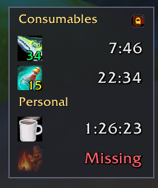
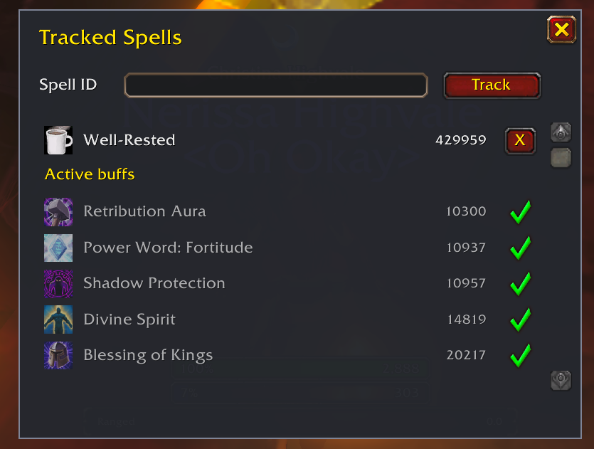
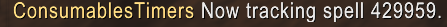
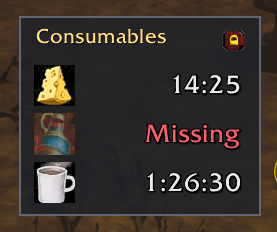

# ConsumablesTimers

A compact in-game window for **World of Warcraft: Forever** that shows your Well Fed and temporary weapon effect timers. Track more buffs with a slash command and enable a large reminder for missing buffs outside combat.



## Install

1. On GitHub, select **Code → Download ZIP** and extract it.
2. Open the extracted project and copy the inner [`ConsumablesTimers`](ConsumablesTimers/) folder into your WoW Forever `Interface\AddOns` folder. After copying, check for this file.

   ```text
   World of Warcraft\_forever_\Interface\AddOns\ConsumablesTimers\ConsumablesTimers.toc
   ```

3. Launch Forever or type `/reload` if it is already open, then enter `/ct` to open settings.

## Customize the display

- **Timers** appear in and out of combat by default. You can hide them during combat or mute the addon in the world, dungeons, and raids independently.
- **Missing** appears in red by default. Choose a preset swatch, open the color picker, or enter a hex code. You can also edit labels, text, fonts, and sizes. Select **Apply text settings** to save those changes.
- **Warnings** can show a large message when tracked buffs are missing outside combat.
- **The padlock** in the upper-right corner lets you move the timer window and warning. The padlock hides and settings are locked during combat.


The weapon row displays the longest remaining temporary effect across equipped weapons, including oils, stones, poisons, and imbues. When WoW restricts access to a timer, its row shows **In Combat** during combat and **Unavailable** outside combat.


## Track another buff

Open `/ct tracking` to see each added spell's icon, name, and ID. Under **Active buffs**, click the green checkmark beside a faded row to start tracking it. You can also enter a **buff aura** ID and click **Track** or press Enter. Click the **X** next to a tracked spell to remove it.



Using `/ct` or `/ct tracking` in combat shows a warning to open the window after combat.

You can also add an ID from chat. For example, enter `/ct add 429959` to track spell `429959`.



Well-Rested (`429959`) gets its own row below the two default timers.



| Command | Action |
| --- | --- |
| `/ct` | Open settings. |
| `/ct tracking` | Open the window for adding and removing tracked spell IDs. |
| `/ct add <spellID>` | Track a buff by its aura spell ID. |
| `/ct remove <spellID>` | Remove an added buff. |
| `/ct label <spellID> <text>` | Change an added buff's display label. Omit the text to reset it. |
| `/ct list` | List tracked buffs. |
| `/ct lock` or `/ct unlock` | Lock or unlock the timer and warning positions. |
| `/ct resetposition` | Restore the timer and warning positions. |
