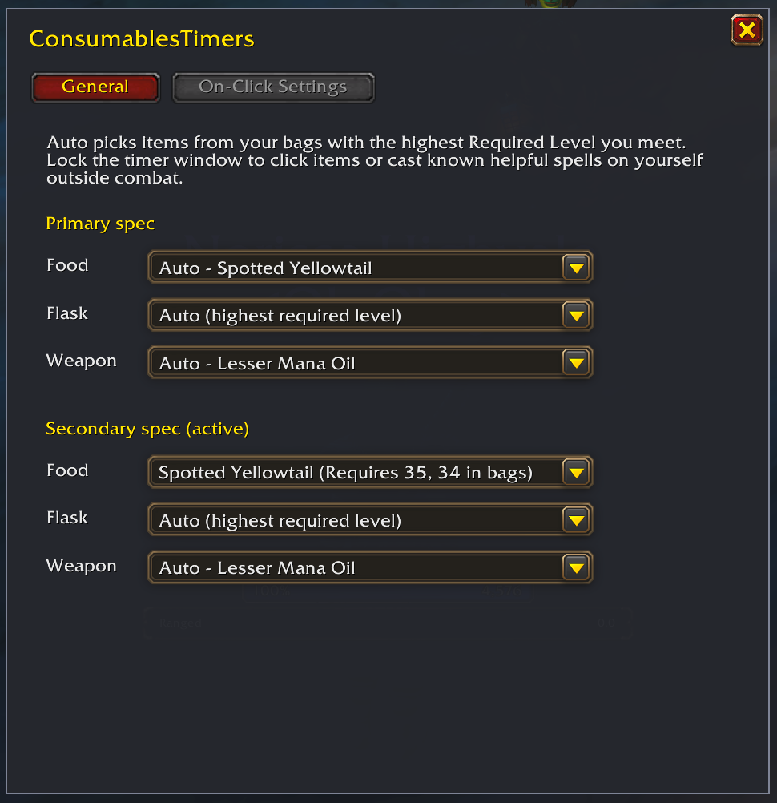
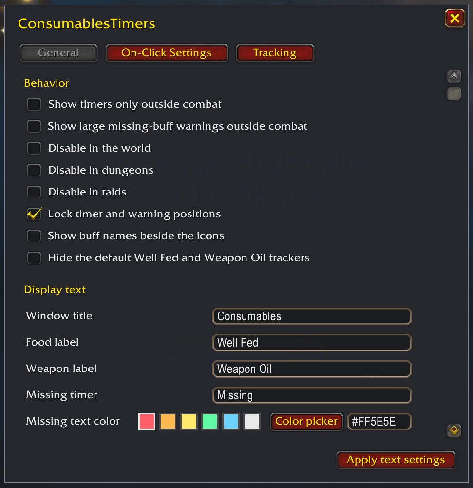
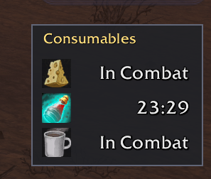

# ConsumablesTimers

A compact timer and click-to-use window for **World of Warcraft: Forever**. Keep an eye on Well Fed, weapon enhancements, and any extra buffs you choose to track.

[Download](https://github.com/harsherwords/ConsumablesTimers/releases/latest) · [Install](#install) · [Track buffs](#track-buffs) · [On-Click Settings](#on-click-settings) · [Customize](#customize) · [Commands](#commands)

<p align="center">
  
</p>

## Install

1. Open the latest [GitHub Release](https://github.com/harsherwords/ConsumablesTimers/releases/latest) and download **`ConsumablesTimers.zip`** under **Assets**.
2. Extract the ZIP directly into your WoW Forever `Interface\AddOns` folder. The archive creates the `ConsumablesTimers` folder at this path.

   ```text
   World of Warcraft\_forever_\Interface\AddOns\ConsumablesTimers\ConsumablesTimers.toc
   ```

3. Launch Forever or type `/reload` if it is already open. Enter `/ct` to open settings.

## Track buffs

**Well Fed** and **Weapon Oil** are tracked by default under **Consumables**. Weapon Oil covers temporary enhancements such as oils, sharpening stones, and weightstones.

**Weapon Imbue** has its own timer for Warlock Firestones and Spellstones, Rogue poisons, and Shaman imbues. The row also appears for other classes when the game reports an imbue. Each weapon timer shows the longest remaining effect of its type across equipped weapons.

1. Open `/ct tracking` or choose **Tracking** in `/ct`.
2. Under **Active buffs**, choose a category and click the green checkmark next to a faded row. To add a buff by ID, enter its **aura spell ID**, choose a category, and click **Track** or press Enter. For example, Well-Rested is `429959`.
3. Use a tracked row’s dropdown to move it between **Consumables**, **Party & Raid**, and **Personal**. Each populated category gets its own section in the timer window. Click **X** to remove a tracked buff. If it is still active, it returns to the faded list.

Each row shows the buff icon, spell name, and spell ID. **Config** returns to your previous settings tab.


## On-Click Settings

In `/ct` → **On-Click Settings**, set **Food**, **Flask**, and **Weapon** for your Primary spec. The Secondary spec pickers appear after you purchase that spec. Choices are saved per character and switch with your active spec.

**Auto** picks the item in your bags with the highest **Required Level** you meet. You can choose an item manually or select **None** to disable its shortcut. The Weapon picker includes oils such as Lesser Mana Oil and Wizard Oil, sharpening stones, weightstones, and other temporary enhancements.



Lock the timer window to use its icons outside combat.

| Icon | Click action | Bag count |
| --- | --- | --- |
| **Well Fed** | Use your chosen food. | Total items on the icon. |
| **Weapon Oil** | Left-click to apply to the main hand. Right-click to apply to the off hand. | Total remaining uses on the icon. Two oils with five charges each show **10**. |
| **Flask** | Use your chosen flask. Add its aura ID in **Tracking** for a buff countdown. | Total items in the row. |
| **Tracked spell** | Cast a known, non-passive helpful spell on yourself. | |

Food and weapon counts are **green** at 21 or more, **yellow** at 2–20, and **red** at 0–1.

## Customize

Open `/ct` → **General** to adjust the timer window.

- **Visibility** can be limited to out-of-combat play. You can also hide the default Well Fed, Weapon Oil, and Weapon Imbue rows or mute the addon independently in the world, dungeons, and raids.
- **Missing-buff warnings** can display a large message outside combat. The **Missing** timer text starts red. Pick a swatch, use the color picker, or enter a hex code to change it.
- **Display text** lets you edit the title, labels, status and warning wording, and text appearance. Click **Apply text settings** to save.
- **Positioning** uses the padlock in the upper-right corner of the timer window. Unlock it to drag the timer or warning and lock it again to enable icon clicks.



### During combat

Timers stay visible by default. When WoW restricts access to a timer, the row reads **In Combat**. Outside combat, restricted timer data reads **Unavailable**. If you try `/ct` or `/ct tracking` in combat, the addon shows an on-screen and chat warning asking you to leave combat.



## Commands

| Command | Action |
| --- | --- |
| `/ct` or `/ct options` | Open settings. |
| `/ct tracking` | Open the tracked spells window. |
| `/ct add <spellID>` | Track a buff by its aura spell ID. |
| `/ct remove <spellID>` | Remove an added buff. |
| `/ct label <spellID> <text>` | Rename an added buff. Use `wellfed` or `weapon` for the built-in labels. Omit the text to reset the label. |
| `/ct list` | List tracked buffs. |
| `/ct lock` or `/ct unlock` | Lock or unlock the timer and warning positions. |
| `/ct resetposition` | Restore the timer and warning positions. |
| `/ct help` | List commands in chat. |

See the [changelog](CHANGELOG.md) for version history.
